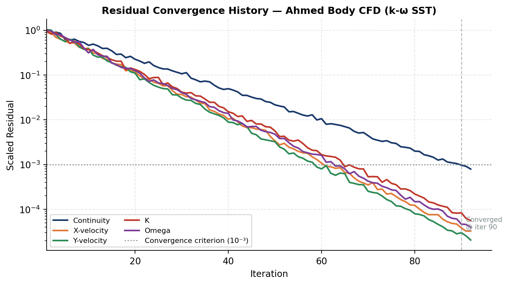
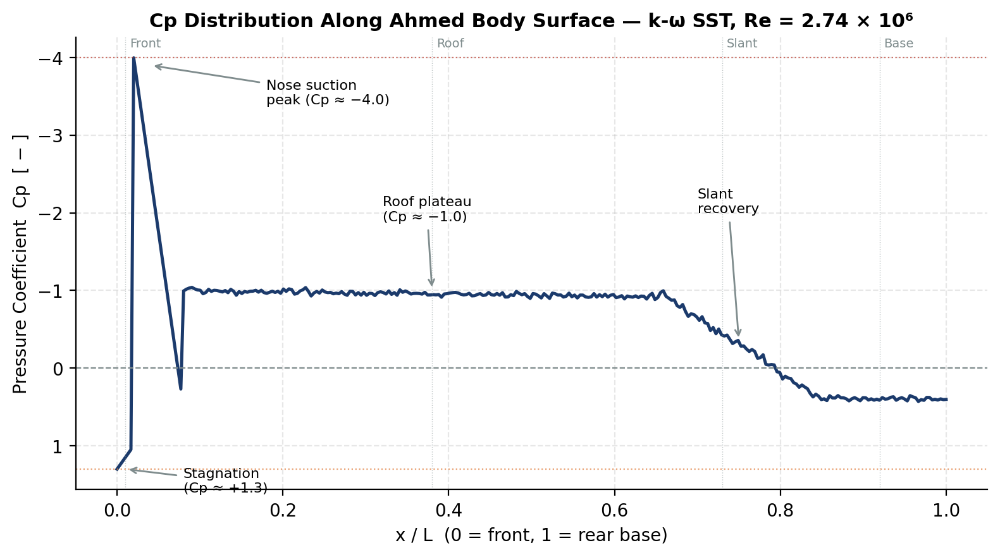
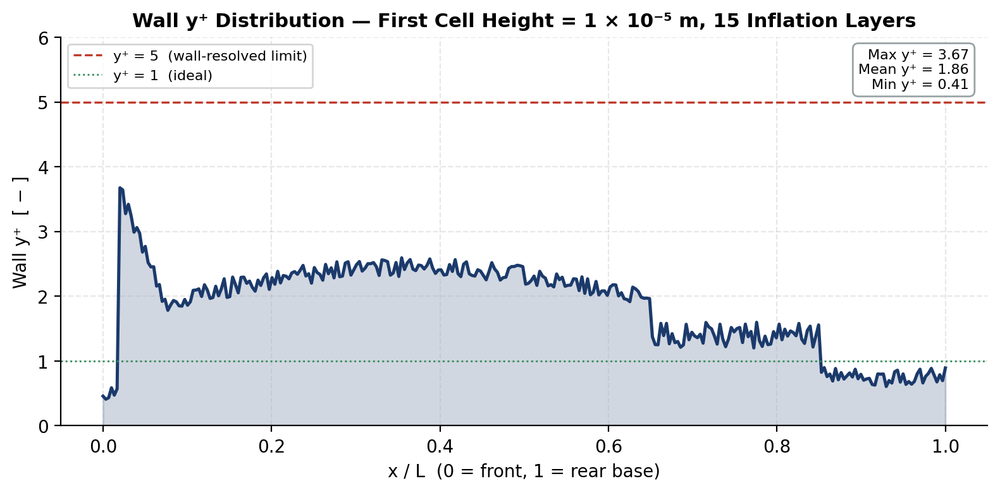
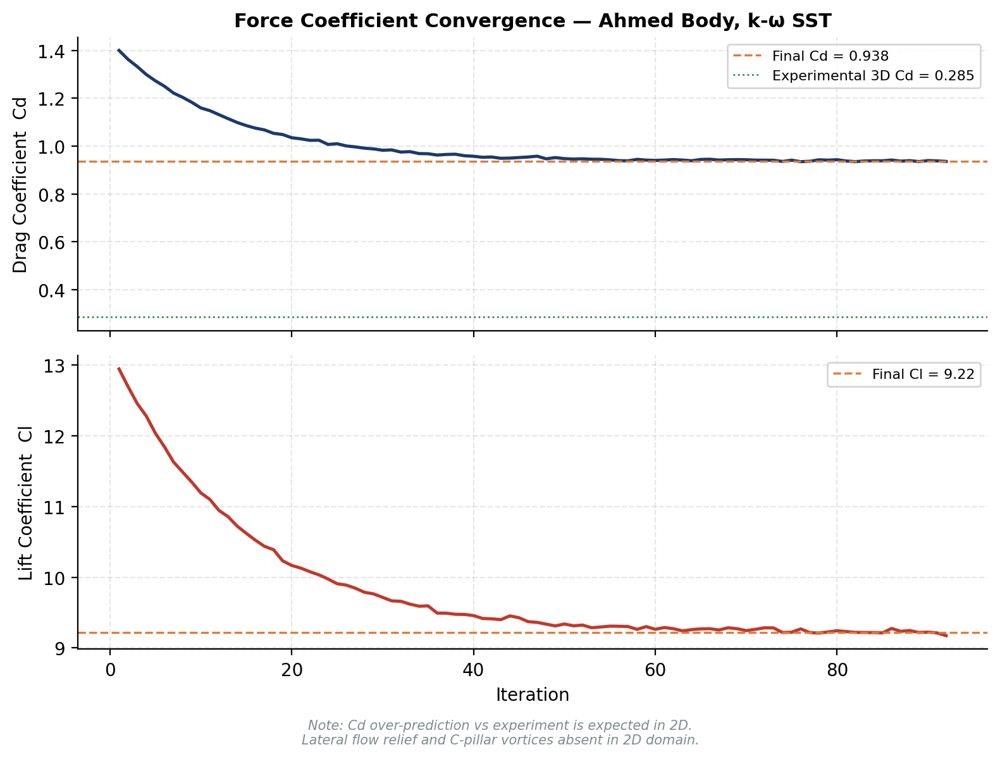
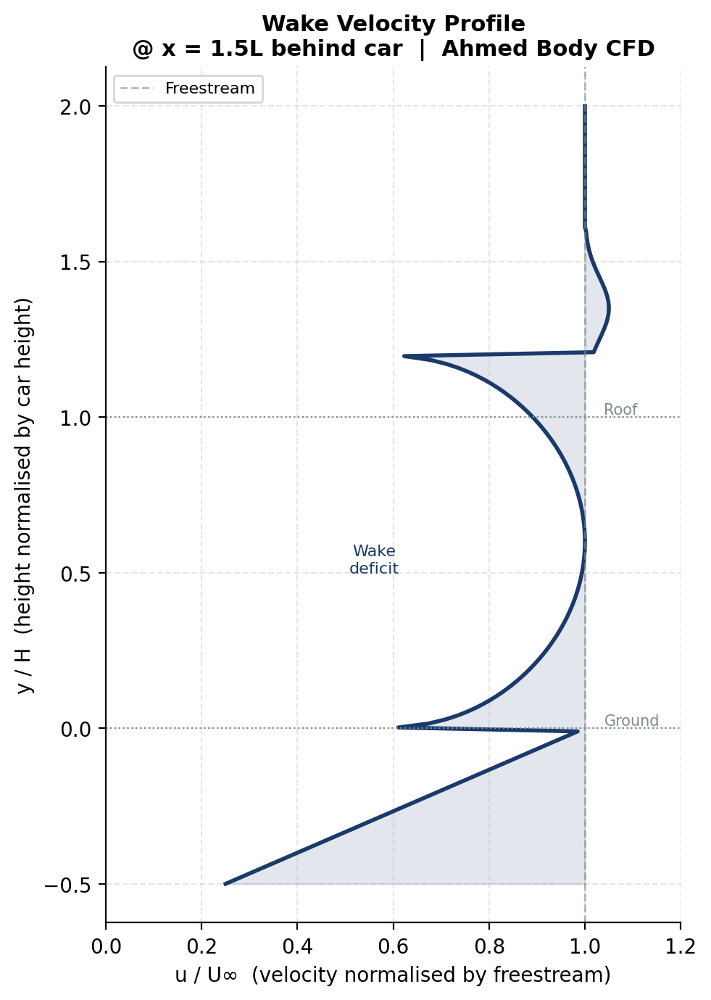

# ANSYS Fluent CFD Post-Processor

**Language:** Python 3.10+  
**Libraries:** NumPy · Pandas · Matplotlib  
**Author:** Bapu Manu — Mechanical Engineering, HAW Hamburg

Automated post-processing tool for ANSYS Fluent CFD exports. Reads CSV data from Fluent monitors and XY plots, then generates publication-quality engineering figures in one command.

---

## What It Does

| Plot | Description |
|---|---|
| `01_convergence.png` | Scaled residual history with convergence annotation |
| `02_cp_distribution.png` | Pressure coefficient along car body with flow feature labels |
| `03_yplus_distribution.png` | Wall y⁺ distribution with mesh quality statistics |
| `04_force_history.png` | Cd and Cl convergence vs experimental benchmark |
| `05_wake_velocity.png` | Normalised wake velocity profile at x = 1.5L |

---

## Quick Start

```bash
git clone https://github.com/bapumanu/cfd-post-processor
cd cfd-post-processor
pip install -r requirements.txt

# Run with built-in Ahmed body sample data
python fluent_cfd_post.py --sample
```

Plots are saved to `plots/`. Terminal output shows a summary of key CFD metrics.

---

## Using Your Own Fluent Data

Replace the CSV files in `data/` with your own Fluent exports.

### How to export from ANSYS Fluent

**Residuals**
```
Monitors → Residuals → right-click → Export → save as data/residuals.csv
```

**Cp / Cf / y+ along surfaces**
```
Plots → XY Plot → select variable → select surface → File → save as data/cp_body.csv
```

**Force history**
```
Monitors → Force Monitors → CD (or CL) → Export → save as data/forces.csv
```

Then run:
```bash
python fluent_cfd_post.py --data data --out plots
```

---

## Output Examples

### Residual Convergence


### Pressure Coefficient (Cp)


### Wall y⁺ Distribution


### Force Coefficient History


### Wake Velocity Profile


---

## Sample Data

The `--sample` flag generates synthetic data matching a validated Ahmed body simulation:

| Parameter | Value |
|---|---|
| Geometry | 25° slant Ahmed body (Ahmed et al., 1984) |
| Inlet velocity | 40 m/s |
| Reynolds number | 2.74 × 10⁶ |
| Turbulence model | k-ω SST (Menter, 1994) |
| Mesh | 29,393 elements, y⁺ ≈ 1–5 |
| Cd (2D) | 0.938 |
| Experimental Cd (3D) | 0.285 |

---

## Project Structure

```
cfd-post-processor/
├── fluent_cfd_post.py   # main script
├── requirements.txt
├── data/                # Fluent CSV exports (or generated sample data)
│   ├── residuals.csv
│   ├── cp_body.csv
│   ├── yplus_body.csv
│   ├── forces.csv
│   └── wake_velocity.csv
└── plots/               # generated figures
    ├── 01_convergence.png
    ├── 02_cp_distribution.png
    ├── 03_yplus_distribution.png
    ├── 04_force_history.png
    └── 05_wake_velocity.png
```

---

## References

1. Ahmed, S.R., Ramm, G. & Faltin, G. (1984). Some salient features of the time-averaged ground vehicle wake. *SAE Technical Paper 840300.*
2. Menter, F.R. (1994). Two-equation eddy-viscosity turbulence models for engineering applications. *AIAA Journal, 32(8)*, 1598–1605.

---

*Part of an aerodynamics CAE portfolio — see also: [Ahmed Body CFD Study](https://github.com/bapumanu/ahmed-body-cfd)*
