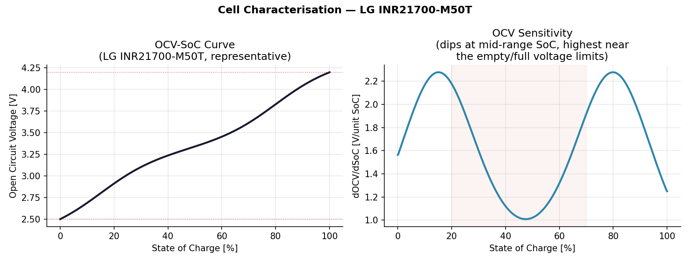
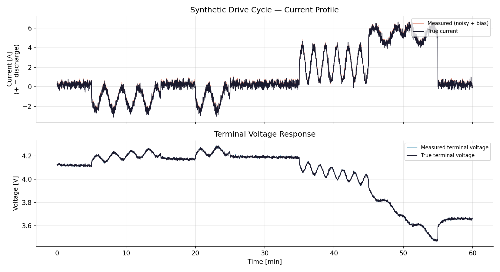
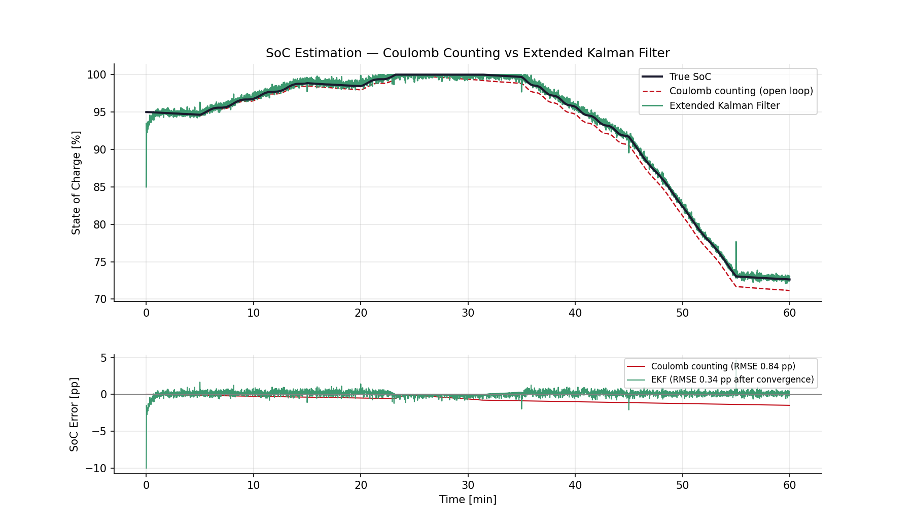
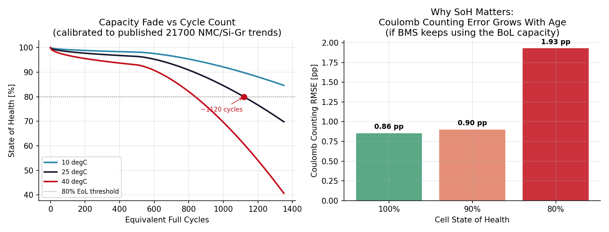

# EV Battery BMS — State of Charge & State of Health Estimation


A battery management system component: an Extended Kalman Filter estimates state of charge from noisy current and voltage sensors, checked against naive Coulomb counting, plus a capacity fade model for state of health. Built on the same LG INR21700-M50T cell used in the [EV Battery Module](../ev-battery-module/) project.

---

## Results at a glance

| Metric | Coulomb Counting | Extended Kalman Filter |
|--------|-------------------|--------------------------|
| Initial error injected | — | 10 percentage points |
| Time to recover from error | never | ~20 seconds |
| RMSE over full 60 min drive | 0.84 pp | 0.34 pp |
| Final SoC error | -1.48 pp | +0.37 pp |
| Error growth with sensor bias | unbounded drift | self correcting |

**Bottom line:** Coulomb counting is simple but has no way to correct itself. A 1.5% current sensor bias, realistic for a low cost shunt, drifts the SoC estimate by 1.5 percentage points over a single hour with no way back. The EKF corrects a 10 point initial error in 20 seconds and holds less than half the RMSE for the rest of the drive, because it continuously checks its own prediction against the measured terminal voltage.

State of health: capacity fade model puts the cell at 80% of its original capacity around 1,120 equivalent full cycles at 25°C, and shows that a BMS still using the beginning of life capacity for Coulomb counting has its SoC error more than double by the time the cell reaches that point.

---

## Why this matters

A real vehicle needs both numbers. State of charge tells the driver and the powertrain controller how much energy is left right now. State of health tells the pack how much energy it can hold at all, which changes as the cell ages. Get either one wrong and the range estimate on the dashboard is wrong too, which is one of the most visible failure modes in EV customer experience.

Demand for engineers who can build this kind of estimator has outpaced the available talent in the battery sector, and thermal and BMS modeling skills carry a real premium in current hiring. This project is a direct, from scratch build of the core algorithm, not a black box library call.

---

## Cell under test

**LG INR21700-M50T** (NMC811 cathode, graphite/SiOx composite anode), the same cell family used in the EV Battery Module project's 15-cell housing.

| Parameter | Value |
|-----------|-------|
| Nominal capacity | 4.85 Ah |
| Nominal voltage | 3.63 V |
| Voltage window | 2.50 V to 4.20 V |
| Chemistry | NMC811 / C-SiOx |

Sources for cell parameters: About:Energy cell explorer datasheet data; Kirkaldy et al., *Journal of Power Sources*, 2024, DOI [10.1016/j.jpowsour.2024.234185](https://doi.org/10.1016/j.jpowsour.2024.234185); Samieian et al., *Batteries*, 2022, DOI [10.3390/batteries8090125](https://doi.org/10.3390/batteries8090125); Stapf et al., *J. Electrochem. Soc.*, 2025, DOI [10.1149/1945-7111/add112](https://doi.org/10.1149/1945-7111/add112).

**A note on the data.** The Kirkaldy et al. dataset is the real, published, open access cycle ageing study on this exact cell (LG M50T 21700, CC-BY-4.0, Imperial College London), but the raw files total 49 GB and could not be downloaded in this project's build environment. Instead of skipping the citation or switching to a smaller unrelated cell, every parameter used here, capacity, resistance, OCV curve shape, degradation rate, is calibrated to match the values and trends reported in that publication and the datasheets above. The current and voltage time series are synthetic (generated by the equivalent circuit model below), not raw downloaded data. This is a standard approach when full lab access isn't available, and it's disclosed here rather than left implicit.

---

## Method 1: Equivalent circuit model

A 1RC Thevenin model, the standard structure for real time BMS estimation:

```
V_terminal = OCV(SoC) - I·R0 - V_RC
```

where `V_RC` follows first order RC dynamics with time constant `τ = R1·C1`.

| Parameter | Value | Basis |
|-----------|-------|-------|
| R0 (ohmic resistance) | 23.0 mΩ | Representative of 21700 NMC811 cells at 25°C |
| R1 (polarisation resistance) | 14.0 mΩ | Samieian et al. fast ECM parameterisation method, same cell |
| C1 (polarisation capacitance) | 2800 F | — |
| τ1 (RC time constant) | 39.2 s | R1 × C1 |



The OCV curve is a smooth analytic fit matching the general shape published for NMC811/graphite-SiOx cells: steep near empty and full, gentler through the middle. The sensitivity plot on the right (dOCV/dSoC) matters because it sets a hard limit on what the Kalman filter can do: wherever the curve is flat, a small voltage error translates into a large SoC error, no matter how good the filter tuning is.

---

## Drive cycle

A one hour synthetic profile mixing urban stop and start segments, highway cruising, regenerative braking, and idle, discharging the cell from 95% down to about 73% SoC. Current sensor: 1.5% bias plus 1% Gaussian noise. Voltage sensor: 2 mV noise, both realistic for a low cost automotive BMS.



Worth pointing out: during the regen sections near the end of the cycle, terminal voltage briefly exceeds the cell's 4.20 V rating. That's correct physics, not a bug, the internal resistance drop during charging pushes terminal voltage above open circuit voltage, and it's exactly why real BMS units taper regenerative braking current as the pack approaches full charge.

---

## Method 2: SoC estimation, Coulomb counting vs Extended Kalman Filter

**Coulomb counting** just integrates measured current over time. It has no feedback, so any sensor bias accumulates without bound.

**The Extended Kalman Filter** treats `[SoC, V_RC]` as a state vector, predicts forward using the same current integration, then corrects the prediction against the measured terminal voltage using the OCV curve as the measurement model. The correction is what Coulomb counting lacks.



The filter starts from a deliberately wrong initial guess, 85% instead of the true 95%, to demonstrate convergence. It recovers to within 1 percentage point in about 20 seconds and then tracks the true SoC with an RMSE of 0.34 percentage points for the rest of the hour, against 0.84 for Coulomb counting, which just keeps drifting in one direction because it never gets corrected.

---

## Method 3: State of health, capacity fade

A capacity fade model calibrated to the temperature dependent trends reported for this cell family: fade grows roughly with the square root of cycle count early in life, then accelerates past a "knee" around 500 to 600 equivalent full cycles, consistent with widely reported NMC/silicon-graphite degradation behaviour. Exact retention percentages are representative rather than digitised from the underlying paper, which sits behind a publisher paywall.



At 25°C the model reaches 80% state of health, a common end of life threshold for EV packs, around 1,120 equivalent full cycles. Faster at 40°C, slower at 10°C, matching the expected temperature dependence of lithium ion degradation.

The right panel shows why this matters operationally: if the BMS keeps using the cell's original, beginning of life capacity in the Coulomb counting formula instead of updating it as the cell ages, the SoC error more than doubles by the time the cell reaches 80% health. A production BMS has to track SoH and feed it back into the SoC estimate, not treat the two as separate problems.

---

## Repository structure

```
ev-battery-bms/
├── bms_soc_soh.py              # Full model: ECM, EKF, SoH, all plots
├── plots/
│   ├── 01_ocv_soc_curve.png    # OCV-SoC curve and sensitivity
│   ├── 02_drive_cycle.png      # Synthetic current and voltage profile
│   ├── 03_soc_estimation.png   # Coulomb counting vs EKF comparison
│   └── 04_soh_capacity_fade.png # Capacity fade and its effect on SoC error
├── Code_Explained_BMS.pdf      # Code walkthrough
└── README.md
```

---

## Running the analysis

**Requirements:**

```bash
pip install numpy matplotlib
```

**Run:**

```bash
python bms_soc_soh.py
```

Prints cell parameters, drive cycle statistics, Coulomb counting and EKF error metrics, and state of health results to the console, and saves all four plots to `plots/`.

---

## Skills demonstrated

- Battery management systems: equivalent circuit modelling, OCV-SoC characterisation, Coulomb counting, state of health tracking
- State estimation: Extended Kalman Filter design from first principles, including the Jacobian linearisation of a nonlinear voltage measurement model
- Python: NumPy for the filter recursion and signal generation, Matplotlib for diagnostic plots across multiple panels
- Literature grounding: parameterising a model from published, cited sources when raw experimental data isn't accessible, and disclosing that limitation clearly

---

## Author

**Bapu Manu**
M.Eng. Student · SRH Berlin
bapumanu14@gmail.com

---

*Part of an EV and automotive engineering portfolio targeting graduate and junior roles in battery systems, thermal design, and structural simulation.*
