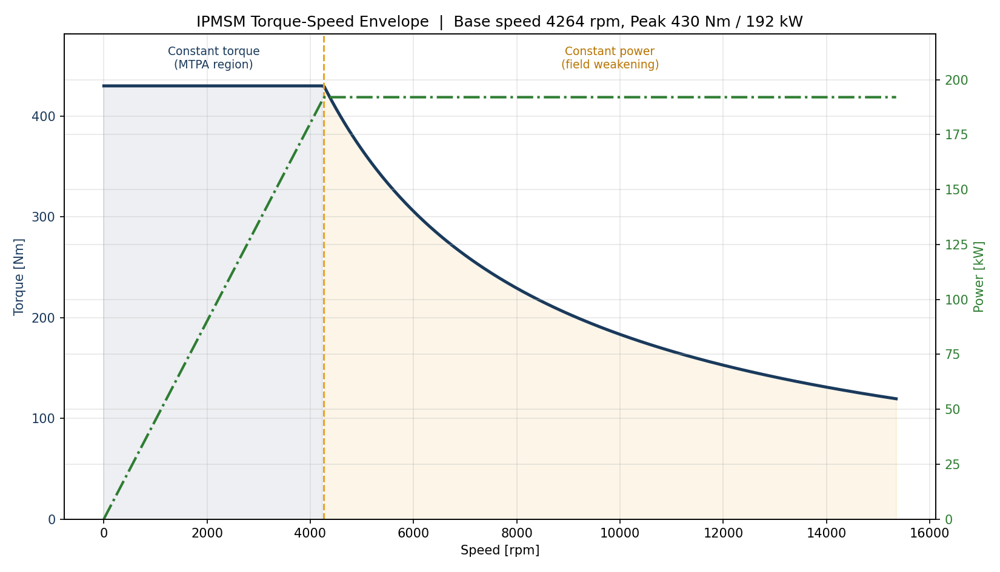
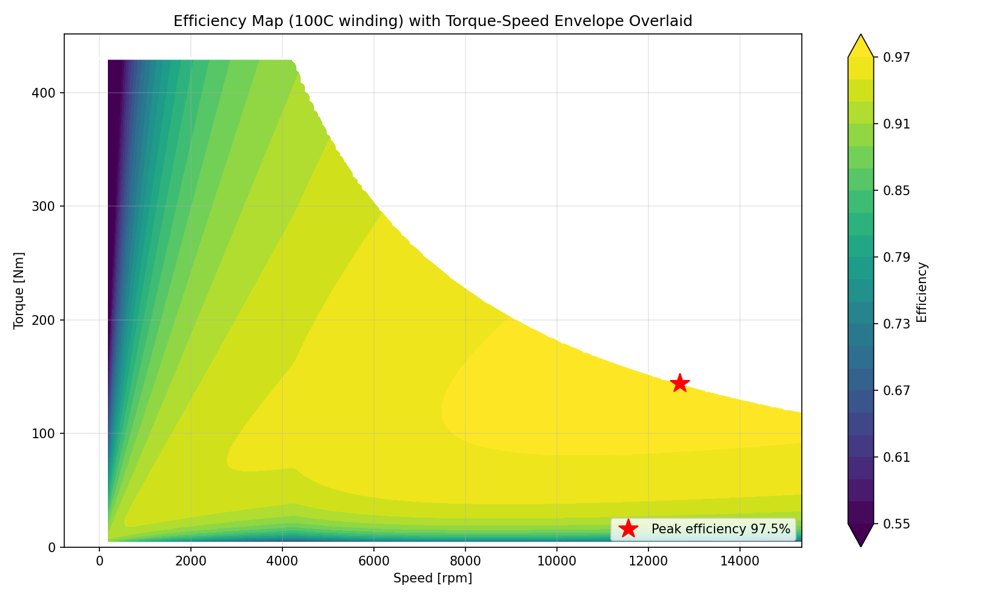
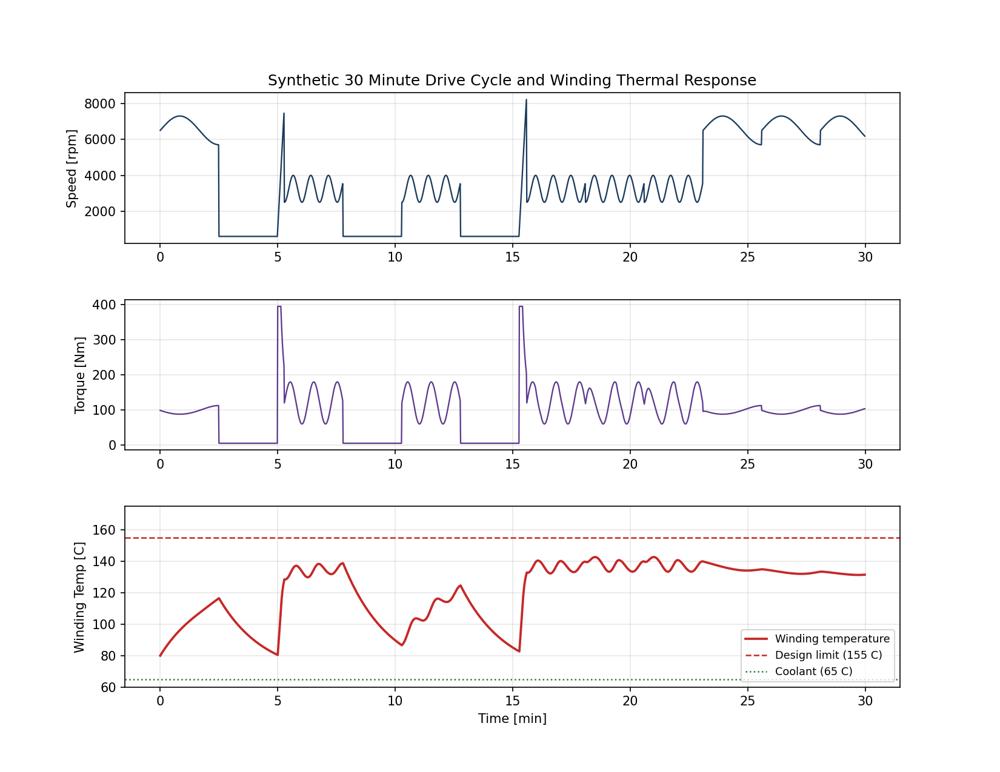
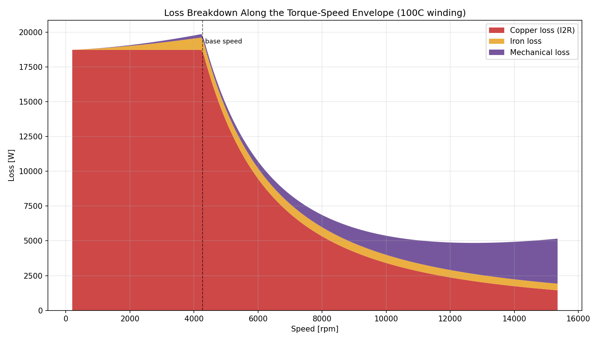

# EV Traction Motor — Torque-Speed Envelope, Efficiency, and Thermal Analysis


A from scratch analytical model of an interior permanent magnet synchronous motor (IPMSM), the dominant EV traction motor topology. Builds the torque speed envelope, an efficiency map, and a thermal response to a synthetic drive cycle complete with the same kind of thermal foldback logic a real motor controller uses to protect the winding under sustained hard acceleration.

---

## Results at a glance

| Metric | Value |
|--------|-------|
| Peak torque | 430 Nm |
| Peak power | 192 kW |
| Base speed | 4,264 rpm |
| Peak efficiency | 97.5%, at 12,682 rpm / 144 Nm |
| Efficiency at rated torque, base speed | 90.6% |
| Winding temperature, 30 minute drive cycle | peaks at 142.8°C against a 155°C design limit |
| Thermal foldback engaged | 8.8% of the drive, during sustained hard acceleration |

**Bottom line:** the motor comfortably meets its published torque and power targets, and the thermal model shows the winding stays within 12°C of its design limit under a demanding synthetic drive cycle, with the controller's thermal foldback logic stepping in during the hardest acceleration bursts rather than letting the winding run away.

---

## Why this matters

Every EV powertrain job description asks for the same underlying skill in different words: understanding how a motor's electromagnetic design, its thermal behaviour, and the vehicle's real world duty cycle all constrain each other. A motor that hits its torque target on a datasheet can still fail in the field if nobody checked what happens to the winding after ten minutes of stop and go traffic followed by a hard highway merge. This project builds that full picture from measured hardware parameters rather than treating the motor as a black box.

---

## Motor under study

**Tesla Model 3 (2018) rear drive unit motor**, a three phase interior permanent magnet synchronous machine.

| Parameter | Value | Source |
|-----------|-------|--------|
| Pole pairs | 3 | Measured (teardown) |
| Stator slots | 54 | Measured (teardown) |
| Phase resistance | 4.75 mΩ at 20°C | Measured (teardown) |
| Stator stack length | 134 mm | Measured (teardown) |
| Stator outer / inner diameter | 225 mm / 151.3 mm | Measured (teardown) |
| Peak torque | 430 Nm | Published + FEA validated |
| Peak power | 190 to 211 kW published range, 192 kW used here | Published + FEA validated |
| Back EMF constant | 42 V peak, line to line, per kRPM | Measured (no load test) |

Source: MotorXP-PM, *Performance Analysis of the Tesla Model 3 Electric Motor using MotorXP-PM*, June 2020. An independent teardown study that physically disassembled a 2018 Model 3 rear drive unit, measured the stator and rotor geometry directly, and validated the manufacturer's published peak torque and power figures against finite element analysis of the reconstructed motor geometry.

**A note on what is measured versus modelled.** The geometry, resistance, pole count, and back EMF constant above come directly from that teardown's physical measurements. The torque speed envelope and peak operating point are drawn from the same study's FEA validated results. Everything past that, the efficiency map, the loss model, the drive cycle, and the thermal response, is a model built on top of those grounded parameters, not measured data from the real motor's controller or coolant loop. The torque to current relationship in particular is simplified to a single linear gain calibrated at the validated peak point, where a real controller uses a full maximum torque per amp current angle schedule. This is disclosed here rather than left implicit.

---

## Method 1: Torque-speed envelope



Below base speed (4,264 rpm) the motor delivers constant torque, the flat top of the curve, limited by how much current the winding and inverter can push through the machine. Above base speed, the controller shifts into field weakening, trading torque for speed to hold constant power out to the maximum speed. This is the fundamental shape of every IPMSM torque-speed curve, and the base speed is not a design choice made separately from the torque and power targets: it falls straight out of them, since base speed is simply the speed at which peak torque and peak power occur simultaneously.

---

## Method 2: Loss model and efficiency map

Three loss mechanisms are modelled: copper loss (I²R in the stator winding, temperature corrected using copper's resistance coefficient), iron loss (hysteresis and eddy current loss in the stator and rotor laminations, which scales with frequency and flux level), and mechanical loss (windage and bearing friction, small but not zero at high speed).



The result is the classic comma shaped high efficiency island seen in real EV motor efficiency maps: a broad band above 96% efficiency covering most of the mid torque, mid to high speed operating region, tapering off toward both very low torque (where fixed iron and mechanical losses dominate a small output) and peak torque at low speed (where copper loss from the high current needed to produce 430 Nm dominates). Efficiency at the rated torque and base speed point is 90.6%, noticeably lower than the map's peak, which is exactly why real drive cycles spend as little time as possible sitting at peak torque and as much time as possible in that mid speed efficiency island.

---

## Method 3: Drive cycle and thermal response

A synthetic 30 minute drive cycle mixes urban stop and start segments, highway cruising, short hard acceleration bursts, and idle. Hard acceleration bursts are deliberately brief, 15 to 25 seconds, matching how peak torque is actually used in a real vehicle: off the line or during a highway merge, not sustained for minutes at a time.



The winding temperature rises fastest during hard acceleration, since copper loss at high current dwarfs the other loss terms, then relaxes during idle and light cruising as heat conducts out to the coolant loop. Over the full cycle, winding temperature peaks at 142.8°C against a 155°C design limit representative of what OEMs use to protect insulation life and magnet demagnetisation margin below the 180°C rating of typical Class H insulation systems.

During the two most demanding acceleration bursts, a thermal foldback controller engages, the same kind of protection real motor drive firmware implements, ramping torque down as the winding crosses 90% of its design limit rather than letting the temperature run past it. Foldback was active for 8.8% of the simulated drive, entirely concentrated in those two bursts, which is a realistic and specific enough result to be useful: it shows precisely when and how often the thermal system, not just the electromagnetic design, becomes the limiting factor.

---

## Loss breakdown across the envelope



Copper loss dominates everywhere on the envelope, unsurprising for a motor whose peak torque point draws roughly 1,000 A of phase current, but its share shrinks steadily with speed as field weakening reduces the torque, and therefore the current, needed to stay on the power limited part of the envelope. Iron loss stays a minor contributor throughout, partly because flux itself falls in the field weakening region, which caps how much the iron loss can grow even as frequency increases. Mechanical loss is the only term that grows monotonically with speed, becoming the second largest loss source at the very top of the speed range even though it started out negligible.

---

## Repository structure

```
ev-traction-motor/
├── traction_motor.py                  # Full model: envelope, losses, efficiency map, drive cycle, thermal
├── plots/
│   ├── 01_torque_speed_envelope.png   # Torque and power vs speed, MTPA and field weakening regions
│   ├── 02_efficiency_map.png          # Efficiency contour map with envelope overlaid
│   ├── 03_drive_cycle_thermal.png     # Drive cycle and winding temperature response
│   └── 04_loss_breakdown.png          # Copper, iron, and mechanical loss vs speed
└── README.md
```

---

## Running the analysis

**Requirements:**

```bash
pip install numpy matplotlib
```

**Run:**

```bash
python traction_motor.py
```

Prints motor parameters, drive cycle thermal statistics, and efficiency map results to the console, and saves all four plots to `plots/`.

---

## Skills demonstrated

- Electric machine fundamentals: IPMSM torque-speed envelope construction, base speed derivation, field weakening operation, MTPA region behaviour
- Loss modelling: copper loss with temperature dependent resistance, iron loss frequency and flux scaling, mechanical loss estimation, and combining all three into an efficiency map
- Thermal system design: lumped parameter thermal modelling, winding temperature response to a duty cycle, and implementing realistic thermal foldback torque derating
- Python: NumPy for vectorised envelope and loss calculations, Matplotlib for multi panel diagnostic plots including filled contour maps and stacked area charts
- Literature and hardware grounding: building a model on top of a real, independently measured teardown study rather than assumed parameters, and disclosing clearly what is measured versus modelled

---

## Author

**Bapu Manu**
M.Eng. Student · SRH Berlin
bapumanu14@gmail.com

---

*Part of an EV and automotive engineering portfolio targeting graduate and junior roles in powertrain engineering, e-drive systems, and CAE.*
