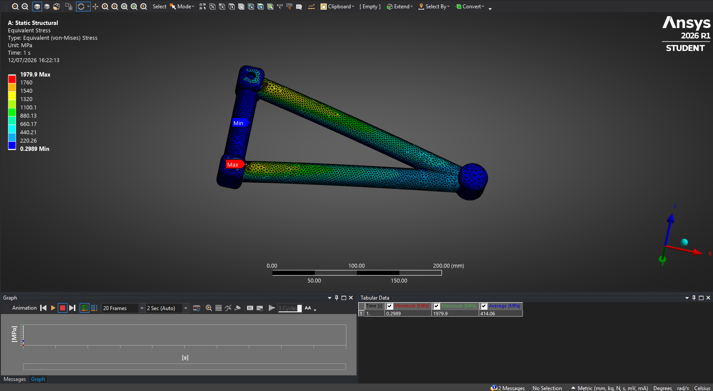
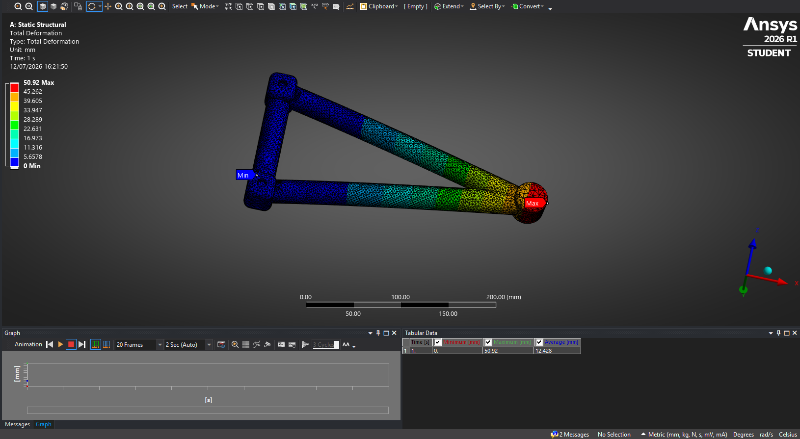
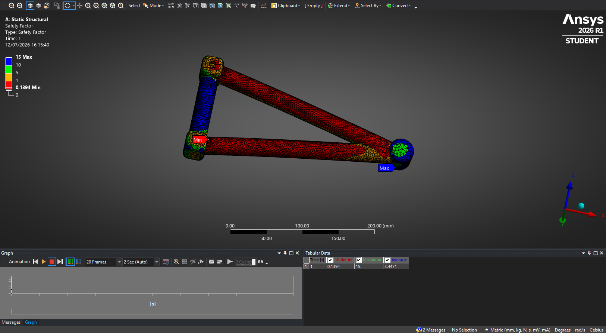

# Porsche 911 (992 GT3) Front Upper Wishbone — Structural FEA Study


A full vehicle dynamics → CAD → FEA chain for the 992 GT3 front upper wishbone. The current tube geometry fails under combined cornering and braking loads — this project finds out by how much, and where.

---

## Results at a glance

| Metric | Value | Target | Status |
|--------|-------|--------|--------|
| Design load case (LC5) | 11,877 N resultant | — | — |
| Arm tube avg. stress | 414.1 MPa | < 110 MPa (FoS 2.5) | ❌ FAIL (1.5× yield) |
| Safety factor (arm average) | 3.45* | ≥ 2.5 | see note |
| Safety factor (min, tube zone) | < 1.0 | ≥ 2.5 | ❌ FAIL |
| Max deformation | 50.92 mm | — | flags oversized slenderness |
| Recommended fix | 20 mm → 25 mm tube OD | — | ~2.4× stiffness gain |

*The average safety factor across the whole body (3.45) is skewed by the ball joint boss region, where stress is low. The arm tubes, which are the actual load path, average 414 MPa, 1.5× over yield. See [Discussion](#discussion) for why the headline average is misleading.

---

## Project overview

The front upper wishbone carries the highest combined loads of any suspension link on the 992 GT3 during cornering and braking. This project builds the full analysis chain from scratch: deriving real wheel loads from vehicle dynamics, modelling the A-arm geometry in Fusion 360, and running static FEA in ANSYS to find where the current design fails and by how much.

The workflow has three phases:

1. **Vehicle dynamics load calculation (Python)**: six load cases derived from 992 GT3 mass, geometry, and peak g-loadings
2. **Fusion 360 CAD**: hollow aluminium A-arm, converging tubes, ball joint boss, inboard mounting flanges
3. **ANSYS static structural FEA**: stress, deformation, and safety factor under the critical combined load case

---

## Vehicle & geometry parameters

| Parameter | Value | Notes |
|-----------|-------|-------|
| Total mass | 1,450 kg | Including driver and fluids |
| Front axle load | 725 kg | 50/50 distribution assumed |
| Wheelbase | 2,457 mm | Porsche 992 specification |
| Track width (front) | 1,522 mm | Porsche 992 GT3 |
| CG height | 480 mm | GT3 lowered ride height estimate |
| Max lateral / longitudinal accel. | 1.5 g / 1.5 g | Nurburgring lap reference |

| Arm geometry | Value |
|--------------|-------|
| Tube outer diameter | 20 mm |
| Tube wall thickness | 2 mm |
| Tube inner diameter | 16 mm |
| Ball joint boss diameter | 35 mm |
| Overall arm span | ~350 mm |
| Material | Aluminium 6061-T6 (σy = 276 MPa) |

---

## Load cases

Six load cases were evaluated across pure cornering, pure braking, and combined scenarios.

| LC | Type | Lateral | Longitudinal | Resultant (N) |
|----|------|---------|---------------|----------------|
| LC1 | Pure cornering | 1.5g | 0g | 8,771 |
| LC2 | Pure cornering | 1.2g | 0g | 7,017 |
| LC3 | Pure braking | 0g | 1.0g | 5,393 |
| LC4 | Pure braking | 0g | 1.5g | 8,090 |
| **LC5** | **Combined (selected)** | **1.2g** | **1.2g** | **11,877** |
| LC6 | Combined (peak, context only) | 1.5g | 1.5g | 14,845 |

LC5 gives the highest resultant force in the upper link and was chosen as the FEA design load case. LC6 was noted for context but not run to FEA. The geometry clearly fails at LC5 first, so a harder case adds no new information.

**Applied at the outboard ball joint face:**
Fz = 6,105 N (vertical) · Fy = 8,346 N (lateral) · Fx = 5,842 N (longitudinal)

---

## FEA setup

| Setting | Value |
|---------|-------|
| Solver | ANSYS Mechanical 2026 R1 |
| Element type | Tetrahedral (generated automatically) |
| Global element size | 3 mm, adaptive sizing |
| Fixed supports | 4 cylindrical bore faces, inboard mounting flanges |
| Applied load | LC5, three force components at outboard ball joint face |
| Material | Al 6061-T6 (E = 68.9 GPa, ν = 0.33, σy = 276 MPa, σu = 310 MPa) |
| Target factor of safety | 2.5 (motorsport structural requirement) |

---

## FEA results

### Von Mises stress



Peak stress of 1,979.9 MPa appears at the inboard fixed support. This is a **stress singularity**, a meshing artefact of applying a mathematically rigid constraint, not a real material stress (see Discussion). The arm tubes themselves read 400–700 MPa across most of their length, well above the 276 MPa yield limit.

### Total deformation



Maximum deformation of 50.92 mm at the ball joint tip, 14.5% of the arm length. A real suspension link should deflect fractions of a millimetre under load, so this number alone signals a structural problem.

### Safety factor



Red zones (FoS < 1) cover most of the arm tubes, so yielding is predicted throughout the structure under LC5. The blue zone at the ball joint boss (FoS > 10) confirms that region is not the weak point; the failure is isolated to the tube cross section.

---

## Discussion

**Stress singularity at fixed supports.** The 1,979.9 MPa peak at the inboard mount is a numerical artefact: in linear static FEA, stress at a point constrained rigidly grows without bound as the mesh refines. It does not represent a real material stress. All conclusions here are drawn from the arm tube regions, away from the constraint boundaries.

**Arm tube stress.** Average von Mises stress across the tubes is 414 MPa, 1.5× the yield strength of Al 6061-T6. To meet FoS = 2.5, allowable stress is 110 MPa, meaning the tubes need to carry roughly four times less stress than they currently do. The cross section has to change.

**Deformation reliability.** At stresses this far above yield, linear elastic assumptions break down and the solver overpredicts deformation. The 50.92 mm figure is not numerically reliable in isolation, but it points to the same conclusion as the stress result.

---

## Design recommendations

| Ref | Strategy | Geometry | Comment |
|-----|----------|----------|---------|
| **R1** | **Increase tube OD** | **25 mm OD, 2 mm wall** | ~55% higher bending stiffness (I scales as d⁴). Low weight penalty, feasible in Al 6061-T6. **Most practical fix.** |
| R2 | Increase wall thickness | 20 mm OD, 3 mm wall | Higher mass than R1, simpler tooling. ~30% stress reduction expected. |
| R3 | Switch to steel (4130 Chromoly) | 16 mm OD, 1.5 mm wall | Higher strength (σy = 460 MPa). Heavier, but standard in club motorsport. |
| R4 | Carbon fibre sleeve reinforcement | Existing Al tube + CF wrap | High stiffness gain at low mass. Complex to fabricate, premium solution. |

**Next steps:** rebuild with 25 mm OD tubes and run the FEA again (predicted peak stress ≈ 170 MPa, FoS ≈ 1.6, closing most of the gap to 2.5); replace the bore hole fixed supports with remote displacement constraints to remove the inboard singularity; run a mesh convergence study at 2, 3, and 5 mm to confirm the current 3 mm mesh is within 5% of a finer solution.

---

## Repository structure

```
porsche-911-wishbone/
├── load_calculator.py           # Vehicle dynamics load case derivation (Python)
├── plots/
│   ├── 01_load_cases.png        # Load case comparison bar charts
│   ├── 02_weight_transfer.png   # Lateral weight transfer & wishbone force curves
│   └── 03_suspension_geometry.png  # Suspension geometry schematic with critical loads
├── fea_stress.png                # ANSYS von Mises stress contour
├── fea_deformation.png           # ANSYS total deformation contour
├── fea_safety_factor.png         # ANSYS safety factor contour
├── Wishbone_FEA_Report.pdf       # Full 8-page engineering report
├── Code_Explained_Wishbone.pdf   # Code walkthrough
└── README.md
```

---

## Running the load calculator

**Requirements:**

```bash
pip install numpy matplotlib
```

**Run:**

```bash
python load_calculator.py
```

Outputs wheel loads and wishbone forces for all six load cases to the console, plus three plots to `plots/`: load case comparison, weight transfer curves, and a geometry schematic with the critical load case annotated.

---

## Skills demonstrated

- Vehicle dynamics: weight transfer under combined lateral/longitudinal acceleration, wishbone force resolution from wheel contact loads
- Python: NumPy vectorised load case sweep, multi panel visualisation in Matplotlib
- CAD: Fusion 360 parametric A-arm modelling, STEP export
- FEA: ANSYS Mechanical static structural analysis, fixed support and multi component force boundary conditions, mesh sizing
- Failure analysis: distinguishing real structural stress from singularity artefacts, translating FEA results into concrete design recommendations

---

## Author

**Bapu Manu**
M.Eng. Student · SRH Berlin
bapumanu14@gmail.com

---

*Part of an EV/automotive engineering portfolio targeting graduate and junior roles in structural simulation, vehicle dynamics, and CAE.*
