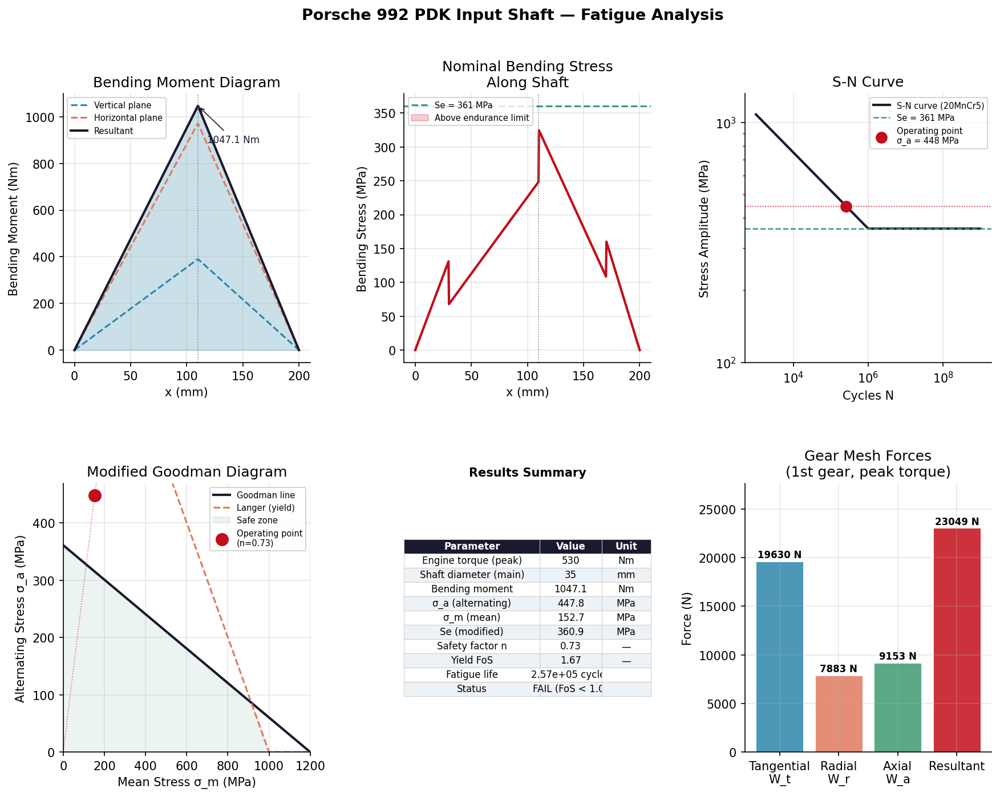
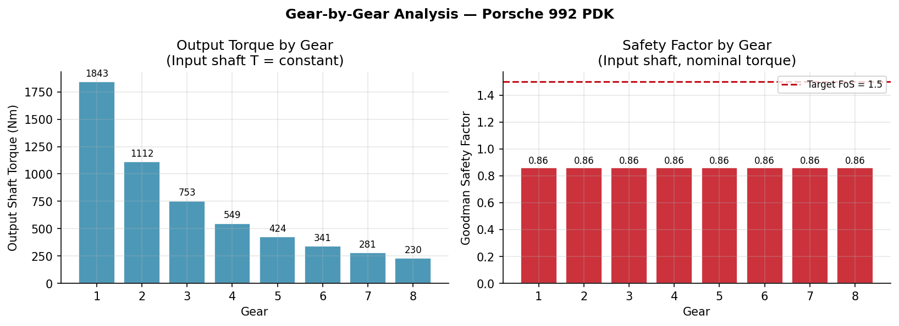
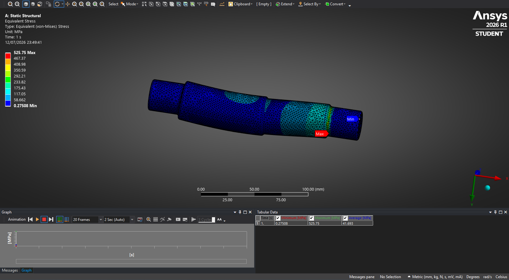
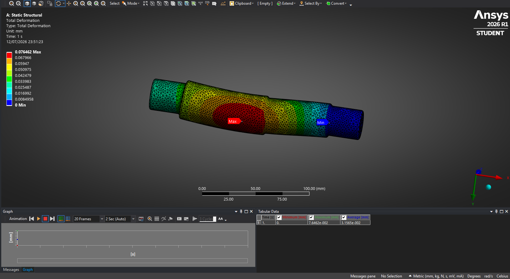
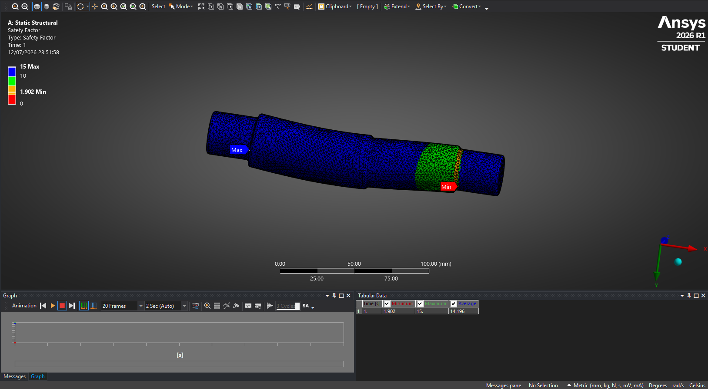

# Porsche 992 PDK Input Shaft — Fatigue Life Analysis


A fatigue study of the Porsche 992 PDK transmission input shaft using two independent methods: a Python Modified Goodman analysis, checked against ANSYS Mechanical FEA. The shaft survives any single load event, but fails the fatigue criterion under sustained peak torque.

---

## Results at a glance

| Metric | Python (Analytical) | ANSYS FEA | Agreement |
|--------|---------------------|-----------|-----------|
| Yield safety factor | 1.88 | 1.90 | < 1% — excellent |
| Goodman fatigue safety factor | **0.84 — FAIL** | not computed | FEA cannot assess fatigue |
| Max deformation | not computed | 0.076 mm (0.038% of length) | FEA additional insight |
| Critical location | shoulder fillet | fixed support (singularity) | singularity masks real zone |

**Bottom line:** the shaft will not yield under a single peak torque event, but the Modified Goodman criterion predicts fatigue crack initiation before rated service life. Static FEA alone can't see this, which is why fatigue analysis is mandatory for rotating powertrain components.

---

## Project overview

This study evaluates the structural integrity and fatigue life of the Porsche 992 PDK transmission input shaft under the worst operating conditions it will see: peak overboost torque of 530 Nm. Two independent methods are run and checked against each other:

1. **Python analytical model**: gear mesh forces, bending moment diagram, Modified Goodman fatigue criterion with Marin correction factors, S-N curve, safety factor swept across all 8 PDK gear ratios
2. **Fusion 360 CAD + ANSYS FEA**: stepped shaft geometry with shoulder fillets, static structural validation

Where the two methods agree (static yield behaviour), that agreement gives confidence in the fatigue prediction, which only the analytical method can produce.

---

## Vehicle & shaft specifications

| Parameter | Value |
|-----------|-------|
| Vehicle | Porsche 911 (992) |
| Transmission | PDK dual clutch, 8 gears |
| Engine torque (nominal / peak overboost) | 450 Nm / 530 Nm |
| Gear pitch radius | 27 mm |
| Pressure angle / helix angle | 20° / 25° |
| Material | 20MnCr5 case hardened steel (HRC 58–62) |
| Sut / Sy | 1200 MPa / 1000 MPa |

**Shaft geometry** (stepped, 200 mm total span):

| Section | Diameter | Length | Position from A |
|---------|----------|--------|------------------|
| Bearing A (left journal) | Ø28 mm | 30 mm | 0–30 mm |
| Main section (gear mount) | Ø35 mm | 80 mm | 30–110 mm |
| Spline section | Ø32 mm | 60 mm | 110–170 mm |
| Bearing B (right journal) | Ø28 mm | 30 mm | 170–200 mm |

Gear mesh at x = 110 mm from Bearing A. Shoulder fillet R = 1.75 mm at all diameter transitions.

---

## Python fatigue analysis

### Gear mesh forces (at peak torque, 530 Nm)

| Force | Value | Physical meaning |
|-------|-------|-------------------|
| Tangential (Ft = T/r) | 19,630 N | Transmits torque; causes bending and torsion |
| Radial / separating (Fr) | 7,883 N | Pushes gears apart; causes bending |
| Axial thrust (Fa) | 9,154 N | Helical tooth thrust along shaft axis |

### Stress concentration & Marin factors

| Factor | Value | Basis |
|--------|-------|-------|
| Kf (bending) | 1.80 | Shoulder fillet r/d ≈ 0.05 |
| Kf (torsion) | 1.40 | Shoulder fillet r/d ≈ 0.05 |
| ka (surface) | 0.865 | Machined journals |
| kb (size) | 0.848 | D = 35 mm |
| ke (reliability) | 0.814 | 99% reliability |
| Se′ (base) | 600 MPa | 0.5 × Sut |
| **Se (modified)** | **358.3 MPa** | All Marin factors applied |

### Modified Goodman result

```
σ_a (alternating) = 379.1 MPa   ← Kf × bending stress, fully reversed
σ_m (mean)        = 152.7 MPa   ← √3 × Kf_t × torsional stress, steady

Goodman FoS = 1 / (σ_a/Se + σ_m/Sut) = 0.84   ← FAIL (< 1.0)
Yield FoS   = Sy / (σ_a + σ_m)        = 1.88   ← PASS
```

FoS < 1.0 on the Goodman criterion means fatigue crack initiation is predicted before the shaft reaches infinite life under sustained peak torque, even though it comfortably survives any single loading event.



Six panel summary: bending moment diagram, bending stress along shaft length, S-N curve with operating point, Modified Goodman diagram, results table, and gear mesh force breakdown.

### Sweep across gears

The input shaft sees the same torque regardless of which of the 8 gears is engaged (torque multiplication happens downstream at the output shaft), so this was checked for completeness.



---

## FEA setup (ANSYS Mechanical 2026 R1)

| Item | Setting |
|------|---------|
| Element size | 2 mm global, refined automatically at fillets |
| Fixed support | Bearing B outer cylindrical face — all DOF constrained |
| Cylindrical support | Bearing A outer cylindrical face — radial fixed, axial free |
| Torsional moment | 530,000 N·mm about shaft axis |
| Gear bending force | 21,153 N transverse (resultant Fr + Ft) on main section |
| Axial thrust | 9,154 N along shaft axis |

### Von Mises stress



Maximum 525.75 MPa at the Bearing B fixed support, a stress singularity artefact from the rigid boundary condition rather than a real material stress. Average working stress across the shaft body is 41.69 MPa; the spline region reads 117–175 MPa, consistent with combined bending and torsion.

### Total deformation



Maximum deflection 0.076 mm at the gear mesh zone, 0.038% of shaft length and geometrically negligible. Zero at the fixed support, maximum near the applied transverse force: a physically correct pattern.

### Safety factor



Minimum static safety factor 1.902 at the junction between the spline and main sections. Most of the shaft (blue) carries a safety factor above 10, confirming the shaft will not yield statically, consistent with the analytical yield FoS of 1.88.

---

## Analytical vs FEA comparison

| Metric | Python Analytical | ANSYS FEA | Agreement |
|--------|--------------------|-----------|-----------|
| Yield safety factor | 1.88 | 1.90 | < 1% — excellent |
| Fatigue safety factor | 0.84 (FAIL) | not computed | FEA cannot assess fatigue |
| Max deformation | not computed | 0.076 mm | FEA additional insight |
| Critical location | shoulder fillet | fixed support (singularity) | singularity masks real zone |
| Failure prediction | fatigue cracking | no static failure | different physical modes |

The close agreement on static yield (1.88 vs 1.90) backs up the load model and geometry, which gives confidence that the fatigue prediction, something FEA alone can't produce without a dedicated fatigue module, is grounded correctly.

---

## Discussion

A Goodman FoS of 0.84 means the shaft as modelled would not survive infinite fatigue life under sustained peak torque. In production, Porsche addresses this through mechanisms not captured in this simplified analysis: case hardening introduces compressive residual stresses that raise the effective endurance limit beyond the bulk material value used here, overboost torque is transient rather than sustained since engine management limits it, and the real gear contact ratio spreads mesh force across multiple teeth rather than concentrating it at a single point.

---

## Design recommendations

| Recommendation | Change | Expected effect |
|-----------------|--------|-------------------|
| Increase fillet radius | R1.75 → R3.5 mm | Reduces Kf from 1.8 to ~1.4; improves Goodman FoS by ~22% |
| Increase main diameter | Ø35 → Ø38 mm | Raises section modulus, reduces bending stress directly |
| Shot peening | Surface treatment | Compressive residual stress raises effective Se by 15–25% |
| Torque limiting | ECU overboost cap | Limits peak torque to brief transients, protecting the shaft |
| Material upgrade | 20MnCr5 → 18CrNiMo7-6 | Sut = 1400 MPa; improves both Goodman and yield margins |

---

## Repository structure

```
porsche-pdk-shaft/
├── shaft_fatigue.py                 # Full Python fatigue analysis (Modified Goodman, Marin factors, S-N curve)
├── plots/
│   ├── shaft_fatigue_analysis.png   # Six panel summary: BMD, stress, S-N curve, Goodman diagram, table, forces
│   └── gear_comparison.png          # Safety factor across all 8 PDK gear ratios
├── von_mises_stress.png             # ANSYS Von Mises stress contour
├── total_deformation.png            # ANSYS total deformation contour
├── safety_factor.png                # ANSYS static safety factor contour
├── PDK_InputShaft.step              # CAD geometry (Fusion 360 export)
├── PDK_Shaft_Fatigue_Report.pdf     # Full engineering report
├── Code_Explained_shaft_fatigue.pdf # Code walkthrough
└── README.md
```

---

## Running the analysis

**Requirements:**

```bash
pip install numpy matplotlib
```

**Run:**

```bash
python shaft_fatigue.py
```

Outputs gear mesh forces, bending moments, fatigue stresses, Marin factors, and the Modified Goodman safety factor to the console, plus a six panel results figure and a safety factor comparison across all eight gears, saved to `plots/`.

---

## Skills demonstrated

- Fatigue analysis: Modified Goodman criterion, Marin surface/size/reliability correction factors, S-N curve construction using Shigley's two point method
- Mechanics of materials: bending moment diagrams for a stepped shaft, combined bending/torsion stress, stress concentration at shoulder fillets
- Python: NumPy analytical modelling, multi panel Matplotlib visualisation with GridSpec
- CAD: Fusion 360 revolve modelling for stepped shaft geometry, STEP export
- FEA: ANSYS Mechanical static structural analysis, cylindrical and fixed support boundary conditions, combined torsional, bending, and axial loading
- Method comparison: using independent analytical and numerical methods to build confidence in a failure prediction that neither method alone could fully support

---

## Author

**Bapu Manu**
MSc Student · SRH Berlin
bapumanu2001@gmail.com

---

*Part of an EV/automotive engineering portfolio targeting Werkstudent and graduate rol